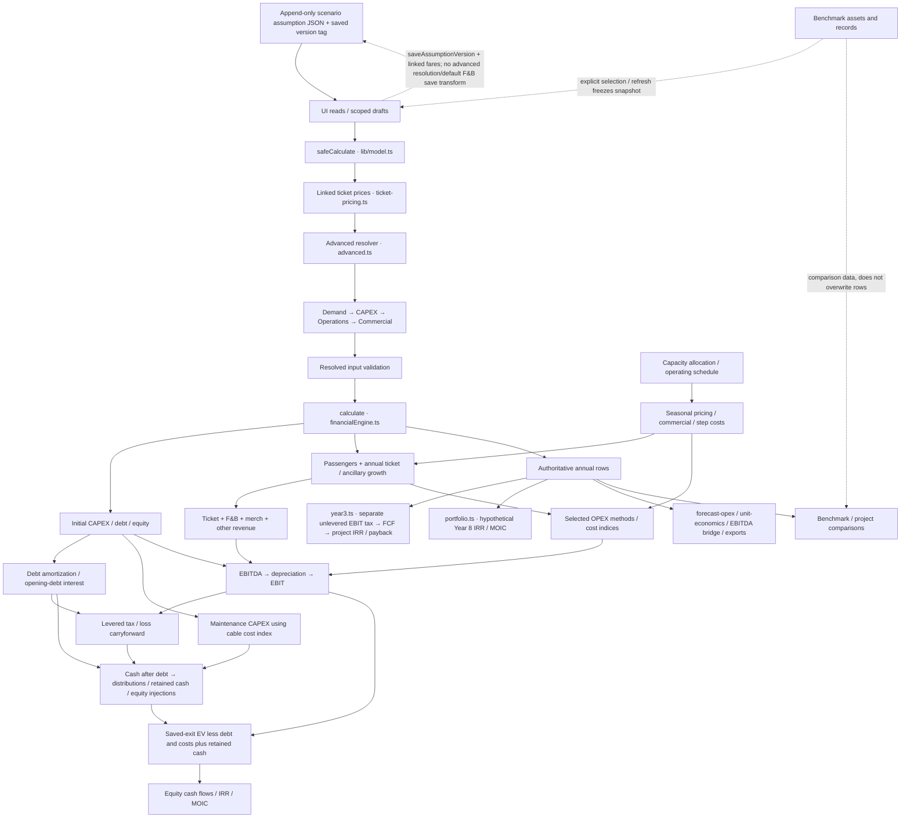

# Calculation dependency map — v1.0

Source identity and full formulas: [specification](specification.md). This maps existing code; dashed edges are input-selection/presentation paths rather than automatic live calculation dependencies.

## Ownership and coupling

| Layer                | Current owners                                                                                           | Change impact / protection                                                                                                                                                                     |
| -------------------- | -------------------------------------------------------------------------------------------------------- | ---------------------------------------------------------------------------------------------------------------------------------------------------------------------------------------------- |
| Saved inputs         | `data.ts`, autosave helpers, scenario JSON, DB constraints                                               | Never persist resolved advanced replacements over preserved manual assumptions. Input changes must be versioned; calculation alone never saves.                                                |
| Precalculation       | `ticket-pricing.ts`, `advanced.ts`, optional module files                                                | Fares and module precedence affect every result. Calling `calculate` directly bypasses this resolution; adapters must be deliberate.                                                           |
| Annual model         | `financialEngine.ts`, `volume-methods.ts`, seasonal/operations helpers, `financial-validation.ts`        | Passengers feed tickets and selected variable/linked methods, not every revenue/cost line. CAPEX feeds funding/depreciation/maintenance; taxes and retained cash carry state across years.     |
| Return derivations   | `year3.ts`, `portfolio.ts`                                                                               | Project FCF uses tax on EBIT; equity uses levered tax and debt. Year 8 presentation returns differ from saved exit. Terminal cash/debt treatment must not be counted twice.                    |
| Breakdowns           | `fb-opex.ts`, `forecast-opex.ts`, `year3.ts`, `unit-economics.ts`                                        | Legacy expense reconstruction duplicates some formulas; exact reconciliation is essential when introducing a new method. Row category expenses take precedence when present.                   |
| Comparisons          | `project-benchmarks.ts`, `year3-bench.ts`, `benchmarks.ts`, `fb-benchmark.ts`, `cable-opex-benchmark.ts` | Forecast-year ticket pricing comes from the row. Grouping, financial year, status, currency and parent passenger basis must match; suggestion/snapshot adapters are distinct from calculation. |
| Exploratory analysis | `sandbox.ts`, `risk-sensitivity.ts`, `break-even.ts`                                                     | Resolve and clone, rerun shared engine, preserve baseline assumptions and frozen provenance. `applyFactors` requires caller-owned clones.                                                      |
| Output/UI            | Project route components, `presentation-data.ts`, presentation/export helpers                            | Prefer row-backed values. Formatting must not round and save assumptions. Currently some definitions remain presentation derivations.                                                          |

The engine already has a shared annual calculation core, but **all financial semantics are not yet in one isolated public contract**. Separate project-return tax, Year 8 exits and legacy breakdowns are real dependencies, and the benchmark helper imports a module that also contains React/database hooks. Those are architecture recommendations, not permission for refactoring in this PR.
